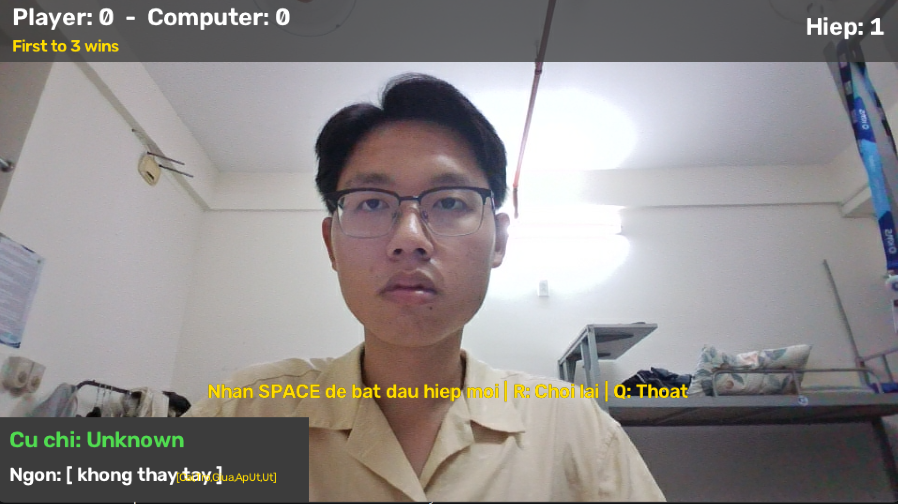
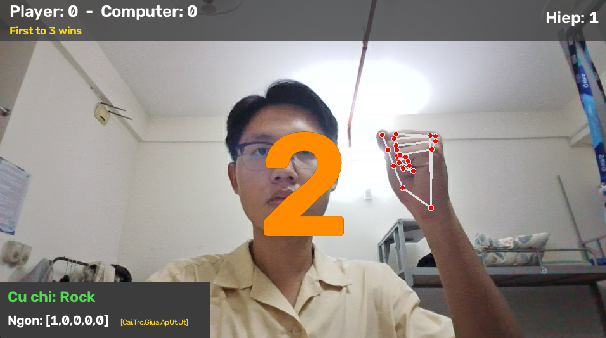
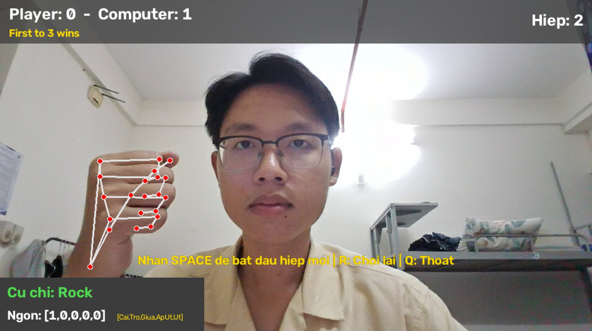
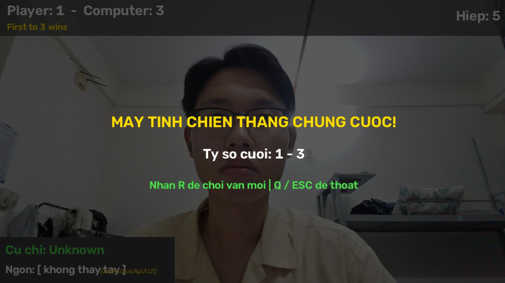

# Rock - Paper - Scissors qua Camera (MediaPipe Hands + OpenCV)

Bài tập lớn môn **Lập trình Python**: trò chơi **Búa - Kéo - Bao** tương tác bằng cử chỉ bàn tay thật trước camera.

Python
OpenCV
MediaPipe

---

## Giới thiệu

Người chơi đưa bàn tay vào camera và thể hiện cử chỉ **Rock (Búa)**, **Paper (Bao)** hoặc **Scissors (Kéo)**. Máy tính chọn ngẫu nhiên một cử chỉ, hai bên được so sánh theo luật chơi, ai đạt **3 điểm trước** sẽ thắng chung cuộc.

Điểm nhấn của project:

- **MediaPipe Hands chỉ dùng để trích xuất 21 landmark** của bàn tay (tọa độ x, y).
- **Thuật toán nhận diện cử chỉ do sinh viên tự xây dựng** bằng các phép so sánh tọa độ đơn giản. Không dùng MediaPipe Gesture Recognizer, không dùng tích vô hướng, góc vector hay lượng giác.
- Giao diện vẽ hoàn toàn bằng OpenCV, không cần file ảnh ngoài.

---

## Sơ đồ quy trình xử lý

```
Camera
  │  (khung hình BGR, đã lật gương cv2.flip)
  ▼
MediaPipe Hands
  │  (chỉ trích xuất dữ liệu đầu vào)
  ▼
21 Landmarks (x, y)
  │
  ▼
Thuật toán phân tích trạng thái ngón tay   ← do sinh viên tự viết
  │  → [Cái, Trỏ, Giữa, Áp út, Út] gồm 0/1
  ▼
Phân loại cử chỉ: Rock / Paper / Scissors / Unknown
  │
  ▼
Game Logic & UI
  (đếm ngược, so sánh với máy, cập nhật điểm, hiển thị kết quả)
```

---

## Cấu trúc thư mục

```
rock-paper-scissors/
├── main.py             # Toàn bộ mã nguồn của trò chơi
├── requirements.txt    # Danh sách thư viện cần cài
├── README.md           # Tài liệu này
└── images/             # Ảnh minh họa dùng trong README
    ├── waiting.png
    ├── countdown.png
    ├── result.png
    └── game_over.png
```

---

## Cài đặt

**Yêu cầu:** Python 3.8 - 3.12 và một webcam hoạt động.

### 1. Tải mã nguồn

```bash
git clone <link-repository-cua-ban>
cd rock-paper-scissors
```

### 2. Tạo môi trường ảo (virtual environment)

**Windows:**
```bash
python -m venv venv
venv\Scripts\activate
```

**macOS / Linux:**
```bash
python3 -m venv venv
source venv/bin/activate
```

### 3. Cài đặt thư viện

```bash
pip install -r requirements.txt
```

### 4. Chạy chương trình

```bash
python main.py
```

---

## Hướng dẫn sử dụng

1. Chạy chương trình, đứng hoặc ngồi cách camera khoảng 50 - 80 cm, đủ ánh sáng.
2. Giơ **bàn tay thẳng đứng, lòng bàn tay hướng về camera**. Ở trạng thái chờ, màn hình hiển thị cử chỉ và mảng 5 ngón tay theo thời gian thực để bạn làm quen.
3. Nhấn **Space** để bắt đầu hiệp mới. Màn hình đếm ngược **3 → 2 → 1**.
4. Giữ nguyên cử chỉ. Đến mốc 0 giây, chương trình chốt cử chỉ của bạn, máy tính chọn ngẫu nhiên và hiển thị kết quả hiệp trong 2.5 giây.
5. Ai đạt **3 điểm trước** sẽ thắng chung cuộc.

### Phím điều khiển

| Phím | Chức năng |
|---|---|
| `Space` | Bắt đầu đếm ngược hiệp mới (ở trạng thái chờ) |
| `R` | Chơi lại ván mới, đặt tỷ số về 0 - 0 (dùng được bất cứ lúc nào, đặc biệt khi ván đã kết thúc) |
| `Q` / `ESC` | Thoát game |

### Các trạng thái của trò chơi

| Trạng thái | Mô tả |
|---|---|
| `WAITING` | Chờ bắt đầu hiệp, hiển thị cử chỉ hiện tại |
| `COUNTDOWN` | Đếm ngược 3 giây (dùng `time.time()` nên không làm đứng camera) |
| `RESULT` | Chốt cử chỉ, hiển thị kết quả hiệp 2.5 giây |
| `GAME_OVER` | Có bên đạt 3 điểm, hiển thị người thắng chung cuộc |

---

## Thuật toán nhận diện cử chỉ (tự xây dựng)

### Hệ tọa độ

Trong OpenCV, gốc tọa độ `(0, 0)` nằm ở **góc trên bên trái** ảnh. Trục X tăng từ trái sang phải, trục Y tăng từ **trên xuống dưới**. Vì vậy điểm nằm **cao hơn** trên màn hình có giá trị **y nhỏ hơn**.

### Các landmark được sử dụng

| Ngón | Đầu ngón (Tip) | Khớp so sánh |
|---|---|---|
| Cái | 4 | 3 (IP), điểm tham chiếu 17 |
| Trỏ | 8 | 6 (PIP) |
| Giữa | 12 | 10 (PIP) |
| Áp út | 16 | 14 (PIP) |
| Út | 20 | 18 (PIP) |

### Bước 1: Xác định trạng thái từng ngón (Duỗi = 1, Gập = 0)

- **Bốn ngón dài:** nếu `y_đầu_ngón < y_khớp_PIP` thì ngón đang **duỗi** (đầu ngón vươn cao hơn khớp). Ngược lại ngón đang **gập**.
- **Ngón cái** (di chuyển ngang nên so sánh theo trục X): ngón cái **duỗi** nếu
  `|x[4] - x[17]| > |x[3] - x[17]|`, nghĩa là đầu ngón cái nằm xa gốc ngón út hơn khớp IP. Dùng giá trị tuyệt đối nên **đúng cho cả tay trái, tay phải và khi lật gương**.

### Bước 2: Phân loại cử chỉ

Mảng có dạng `[Cái, Trỏ, Giữa, Áp út, Út]`. Ngón cái được bỏ qua (`*`) vì nhỏ, di chuyển ngang và dễ nhiễu.

| Cử chỉ | Mảng ngón tay | Mô tả |
|---|---|---|
| **Rock (Búa)** | `[*, 0, 0, 0, 0]` | 4 ngón dài đều gập |
| **Paper (Bao)** | `[*, 1, 1, 1, 1]` | 4 ngón dài đều duỗi |
| **Scissors (Kéo)** | `[*, 1, 1, 0, 0]` | Chỉ ngón trỏ và ngón giữa duỗi |
| **Unknown** | Các tổ hợp còn lại | Không hợp lệ, hiệp đó không tính điểm |

### Giảm nhiễu

Chương trình lưu 5 cử chỉ gần nhất và lấy cử chỉ xuất hiện nhiều nhất, tránh việc tay đang chuyển động bị nhận nhầm.

### Hạn chế

- Chỉ hoạt động tốt khi bàn tay giơ thẳng đứng, hướng lên. Nếu xoay tay nằm ngang, phép so sánh trục Y sẽ sai.
- Ánh sáng yếu hoặc tay bị che khuất làm MediaPipe nhận diện kém.
- Chỉ hỗ trợ một bàn tay trong khung hình.

---

## Video Demo

**Link video:** `https://youtu.be/f7CQtr8a3nQ`

---

## Hình ảnh minh họa

| Trạng thái chờ | Đếm ngược |
|---|---|
|  |  |

| Kết quả hiệp | Kết thúc ván |
|---|---|
|  |  |

---

## Công nghệ sử dụng

- **Python** 3.8 - 3.12
- **OpenCV** (`opencv-python`): đọc camera, vẽ giao diện
- **MediaPipe Hands**: trích xuất 21 landmark bàn tay
- **NumPy**: thư viện nền tảng của OpenCV và MediaPipe

---

## Tác giả

- Họ và tên: `Đặng Phạm Minh Hoàng`
- MSSV: `26520576`
- Giảng viên hướng dẫn: `Trần Nhật Khoa`
